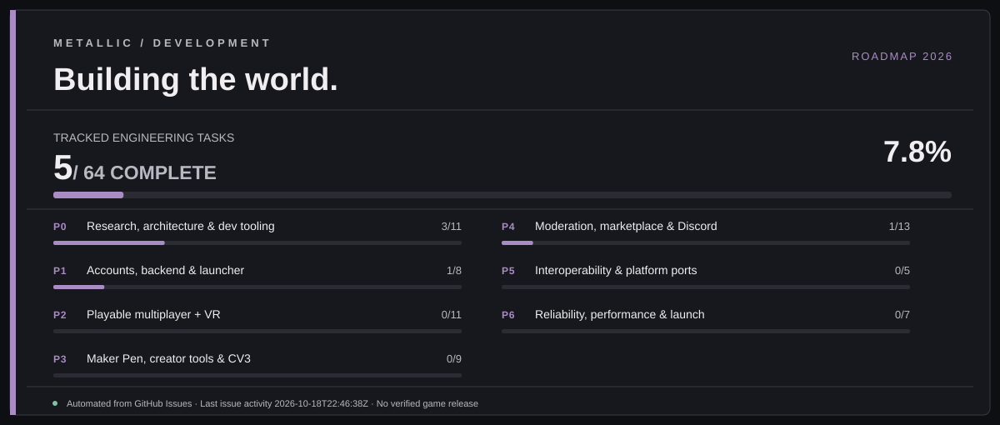

# Metallic-RC

**Project naming:** [Metallic-RC / Metallic-MC / Metallic-RB / Metallic-PX](docs/PROJECT_IDENTITIES.md). Family domain: **Metallic.club** (application routing is not configured by this repository change).

> **Project status: Foundation planning — not yet a playable game.**  
> Independent social multiplayer, VR, and creator platform. The repository starts with a technical roadmap and evidence-based progress tracker; completed features must be proven by merged changes, tests, and working builds.

*This live artwork represents completed GitHub engineering issues, **not** available game builds or real player counts.*

[Original development-status website prototype](docs/site/index.html) · [How to preview the website locally](docs/site/README.md)

## What we are building

Metallic-RC is intended to be an independent, high-performance social game platform with its own client, dedicated servers, launcher, identity service, creator tools, user-generated rooms, visual scripting, and optional integrations with cooperating community projects.

### Product pillars

1. **Cross-device multiplayer:** PC first; VR alongside a shared multiplayer vertical slice; Linux, Android, and iOS after platform validation.
2. **Player-controlled creation:** in-game building, modular prefabs, an asset pipeline, and a next-generation *Circuits V3* typed node graph.
3. **Social platform:** accounts, profiles, friends, parties, rooms, matchmaking, spatial voice, moderation, reporting, and search.
4. **Creator economy:** moderated marketplace, entitlements, auditable token ledger, creator analytics, and optional premium upgrades.
5. **Reliable infrastructure:** authoritative sessions, performance budgets, monitoring, anti-abuse, backups, and defensive network protection.
6. **Open integrations:** an optional, permissioned federation protocol to expose public status and launch other participating projects.

## Live project tracking

- **[Roadmap and milestones](docs/ROADMAP.md)** — scopes, dependencies, test gates, order of delivery.
- **[Live progress dashboard](docs/PROGRESS.md)** — automatically generated from repository GitHub issues; reflects *closed issues*, not claims that binaries are already usable.
- **[Architecture and research guide](docs/ARCHITECTURE.md)** — component boundaries, decisions, performance, and research.
- **[Metallic Atlas backend lab](services/metallic-control/README.md)** — original Go node heartbeat API, pressure-aware reservations and read-only Linux agent with race/HTTP tests; **not deployed, not a real game server**.
- **[Owned hardware and custom infrastructure research](docs/METALLIC_OWN_INFRASTRUCTURE_2026.md)** — observed constraints, workload isolation, advanced server design, cross-device/network goals, and staged deployment safety.
- **[Control-plane API schema](services/metallic-control/openapi.json)** — versioned lab operator/agent API contract; separate from player-facing services.
- **[240-feature capability catalog](docs/FEATURE_CATALOG.md)** — concrete feature candidates and suggested acceptance tests.
- **[Research backlog](docs/RESEARCH.md)** — sources, experiments, unknowns, and competitor review.
- **[Contributor development rules](docs/DEVELOPMENT.md)** — issue labels, PR review gates and evidence requirements.
- **[Visual identity and UI quality system](docs/DESIGN_SYSTEM.md)** — professional interface direction, motion, VFX and anti-generic acceptance checks.
- **[AI players and stress-testing laboratory](docs/QUALITY_AND_STRESS_TESTING.md)** — staged load, synthetic protocol users, game AI and measurable release gates.
- **[Moderation, Discord and staff titles](docs/MODERATION_DISCORD_STAFF.md)** — unified permissions, in-game and web consoles, bot design, Volunteer Mod / Developer title controls.
- **[Trusted player-count aggregator service](services/player-count/README.md)** — authenticated, de-duplicated heartbeat aggregation with separate synthetic-actor tracking (local code only; no live count).
- **[Meta Quest release preparation](docs/META_QUEST_RELEASE.md)** — Horizon Store, channels, ARM64 build quality and verification.
- **[Live website prototype](docs/site/index.html)** — handcrafted responsive layout reading the generated aggregate progress JSON.
- **[Tracked work items](../../issues)** — one issue per verifiable deliverable.
- **[Pull requests](../../pulls)** — proposed changes and review history.

The `Update project progress` GitHub Actions workflow refreshes the Markdown dashboard after relevant issue/PR changes, on demand, and daily. Issues use `[P0]` to `[P6]` title prefixes; the updater counts open/closed issues in each stage and refuses to fabricate implementation progress. An issue should close only when its linked acceptance tests have passed.

## Initial milestone

**First playable vertical slice:** a signed desktop test build connects to an independently hosted authoritative server, joins a room with two players, replicates movement, shows a basic avatar, sends optional positional voice, and survives reconnects. We deliberately defer marketplace, account import, and federation until the foundation is safe and testable.

## Platform and tech candidates

- **Client:** Unity + OpenXR **or** a tested Godot/OpenXR path; decision recorded after performance and licensing comparison.
- **Backend:** Rust or Go authoritative game sessions; a modular HTTP API; PostgreSQL; Valkey; object storage; OpenTelemetry.
- **Website + launcher:** TypeScript web console, Tauri/Rust desktop launcher candidate.
- **Creator runtime:** versioned graph schema, deterministic/server-authoritative execution for trusted game logic.
- **Infrastructure:** self-owned machines for dev/test; provider-protected networking for public UDP sessions. Cloudflare's regular HTTP proxy is not a complete UDP game-server DDoS solution.

Technology choices remain proposals until measured prototypes and an architecture decision record (ADR) are committed.

## Principles

- Report **planned / in progress / blocked / tested / released** separately.
- Never equate issue closure to real-world benchmark or player availability.
- No secrets or other people's account credentials in issues, logs, or import forms.
- Only show external community player counts when a project willingly publishes trustworthy aggregate figures.
- User-facing import flows require available source data, explicit consent, and a supported verification path.

See [ROADMAP](docs/ROADMAP.md) for the implementation sequence and [PROGRESS](docs/PROGRESS.md) for live status.
