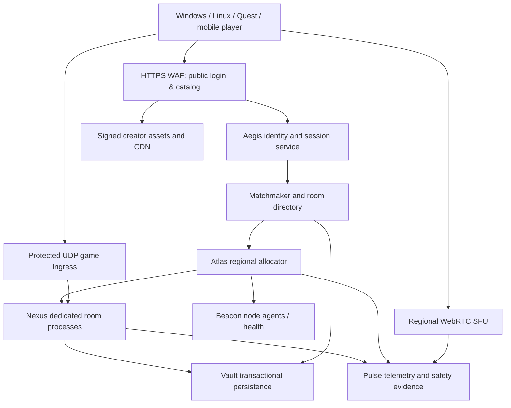

# Metallic — Owned Hardware, Original Backend and Advanced Server Systems

**Research / hardware observation:** 2026-10-18. **State:** engineering plan + first locally testable control-plane prototype. **No actual Metallic multiplayer session, public API deployment, 10k CCU stress result, platform superiority, or secure production rollout has been demonstrated.** This document is not permission to alter existing Star AI workloads, network settings, partitions, panels or services.

## 1. Verified hardware observations (read-only; private account remote connections)

Two machines were online during inspection, a third was offline. The observations below are dynamic snapshots and are **not** reliable capacity guarantees; no addresses, tokens, routers, credentials or customer data are recorded.

| Profile | Observed compute | Observed pressure | Storage / network | Conservative interpretation |
| --- | --- | --- | --- | --- |
| AI/compute node (EPYC 7451) | 24 physical / 48 logical CPU threads; ~125 GiB installed RAM; Linux 6.8 | load ~22.7, ~80 GiB used RAM, ~7.1 GiB of 8 GiB swap used | root ~89% full, ~23 GiB free; *separate* ~9.8 TiB rotational volume with ~9.2 TiB free; 1 Gb/s + 10 Gb/s **NIC link capability**, not verified ISP throughput | strong **potential** for compute workers once measured and isolated; large model processes already compete for RAM; full root and swap pressure are stop conditions |
| Secondary node (i7-9700) | 8 CPU cores; ~15 GiB installed RAM; Linux 6.8 | load ~7.2, ~11 GiB used RAM, ~3.6 GiB of 4 GiB swap used | root ~25% full, 1 Gb/s NIC; Docker present; Pterodactyl configuration exists | can trial a small, isolated control-plane workload **if spare capacity is actually released**, but not presently a clean empty server |

**What is unknown:** WAN upload speed/ISP cap, CGNAT, static IP availability, public UDP DDoS coverage, same LAN/power failure domains, SSD latency/IOPS, thermal stability, GPU availability, UPS and backup power, additional hosts, cost of internet traffic, real CPU cycle consumption per room, or existing application owners' reserved budgets. Do not invent any of these. Root and extra disk must be treated as different storage devices; free archival capacity is **not** free fast transactional storage. The offline `Main` device cannot be counted.

### Immediate no-disruption actions recommended

1. **Inventory resource commitments before installing anything:** process/container owners, workload memory peaks, SLAs for Star AI inference and existing hosted servers, maintenance windows. Do not kill existing `llama-server` processes, stop Pterodactyl, delete data, enable port forwarding or move storage.
2. **Fix resource contention first:** measure swap in/out, disk IO wait, per-core load and p95 inference/game frametimes. Reduce model concurrency or relocate models *only with explicit operational approval*. Set conservative cgroup v2 resource isolation via systemd slices/containers after testing. Linux [cgroup v2](https://www.kernel.org/doc/html/latest/admin-guide/cgroup-v2.html) provides CPU, memory and pressure interfaces; [systemd.resource-control](https://www.freedesktop.org/software/systemd/man/latest/systemd.resource-control.html) exposes CPUQuota, CPUWeight, MemoryHigh/Max, IOWeight and others. Verify actual host cgroup hierarchy and systemd configuration first.
3. **Do not write game cache, DB or logs into near-full root.** The large separate HDD could hold encrypted backups or immutable archives *after* ownership/mount and IO profiling, but latency-critical PostgreSQL and hot world assets need measured fast storage and backup isolation. Reserve space for snapshots, OS updates and crash dumps.
4. **Treat the 10Gb NIC as an opportunity, not confirmed 10Gb throughput.** Validate negotiated physical path, switch, link errors, `iperf3` between **owned** hosts, Internet uplink/ISP contracts, peak jitter and bufferbloat. A 1Gb external uplink cannot magically carry unrestricted thousands of voice/media streams.
5. **Apply a default no-admission policy until healthy:** pressure-aware scheduler rejects stale metrics, high swap, disk pressure, draining and high load. The new lab controller does this, but has not been deployed to either machine.

## 2. Architecture: the Metallic-native platform, not a pile of unrelated products

One connected platform with explicit internal ownership:

| Metallic subsystem | Ownership / role | Initial implementation | Long-term evolution |
|---|---|---|---|
| **Atlas Control** | node inventory, health, placement, reservations, draining, regions, capacity | **Go lab API now implemented in PR**, loopback only; no process runner | transactional leader/fencing, Agones/Nomad/cloud adapters, autoscaling controllers and operator approval |
| **Beacon Agent** | read-only node heartbeats, OS pressure signals | **Go Linux unprivileged agent now implemented in PR** | cgroup/PSI, CPU topology, crash telemetry, signed deploy acknowledgements, mTLS and secret rotation |
| **Nexus Runtime** | actual rooms, replicated world simulation, VR poses, physics, circuits and hit validation | NOT built; choose measured Unity/Godot Linux dedicated-server prototype | proprietary optimized server/serialization/AOI layers, later independent native sim only when correctness+performance proven |
| **Sentinel Defense** | server-side checks, anti-cheat telemetry, player protection & appeals | input-gate reference in separate [PR #65](https://github.com/oncoursemail/Metallic-RC/pull/65), NOT integrated | fuzzed authoritative physics, anti-economy fraud, segmented privacy preserving behavioral analyses |
| **Aegis Identity** | own player accounts, access tickets, device linking, MFA, trust policy | proposed | OAuth/OIDC with protected staff API, signed scoped one-time room ticket, audit trail |
| **Studio / Forge** | creator worlds, asset compilation, safety scanner, signed distribution | proposed | content-addressed, versioned room packages with deterministic migrations and creator-budget limits |
| **Vault** | source-of-truth data: profiles, inventory, permissions, ledger | proposed Postgres transactions/backups | region-scoped replicas, outbox, failover drills, careful eventual vs strict consistency rules |
| **Pulse** | real fleet CPU/memory/tick/frame/network/voice reliability observability | lab JSON state counters only, not OTel | OpenTelemetry collector, histograms in Prometheus, Grafana, trace exemplars, incident SLO dashboards |
| **Arc Voice & Edge** | WebRTC spatial audio, regional SFU, DDoS protected UDP | proposed | separate media scaling, cost budget and region continuity, voice safety and consent |
| **Watchtower** | guarded automated rollback, saturation protections, signed release health | proposed | canary gate, policy-protected safe actions, rollback on observed regressions; destructive changes require human approval |

**Plane separation:** client/player API ≠ operator control API; trusted backend ≠ user-created room code; world-state UDP ≠ media SFU ≠ public HTTPS; region and room allocation ≠ player session authentication. Never give browser game clients node tokens or operator tokens.

### End-to-end flow

**Server admission must be atomic** at the allocator's source of truth, never based only on cached or client-claimed free capacity. The local Go prototype uses one Go mutex plus atomic file snapshots, which is suitable for a lab only; regional/multi-writer production needs a database transaction, lease fencing and/or [Agones atomic GameServerAllocation](https://agones.dev/site/docs/reference/gameserverallocation/) as appropriate.

## 3. What the first custom backend *actually implements*

Repository path: [`services/metallic-control`](../services/metallic-control/README.md). Implemented in Go with standard library, Linux agent and race/HTTP tests, no external runtime dependencies. It is **self-built Metallic application logic**, not a wrapped generic panel.

Version 1 lab contract:

- `GET /healthz`: liveness only (no claim of ready region or game server).
- `POST /internal/nodes/{nodeID}/heartbeat`: per-node bearer authentication, strict OS telemetry, stamps observation time on server.
- `GET /v1/nodes`: operator node health and pressure reasons; no secrets.
- `GET /v1/metrics`: simple protected lab counters; not yet Prometheus.
- `GET /v1/reservations`: active room-capacity leases; *not* actual running game rooms.
- `POST /v1/reservations`: idempotency key, validation, region/room limits, conservative static and live capacity gates, new lease.
- `POST /v1/reservations/{id}/renew`: extend active lease; does not resurrect expired lease.
- `POST /v1/reservations/{id}/release`: release reservation; does not stop a process.

Security & correctness implemented: deny stale/offline/draining nodes; deny disk, swap, CPU or memory pressure; distinct node/operator token scopes; reject bad JSON, out-of-range resources, duplicate rooms, conflicting idempotency keys, missing/unknown nodes; mutex lock for concurrent reservation requests; persisted state with 0600 permissions and atomic rename; fail to start on corrupt state. Everything uses **server-selected clock** and **server-owned node specification** rather than an agent's claimed CPU budget.

No privileged shell command endpoint exists. The agent is observational, never accepts remote arbitrary code execution. All binds default to `127.0.0.1:8098`, and external origins require HTTPS on the agent; never publish the lab API to public Internet. Audit, leader locking, vault-backed secret distribution, distributed consensus, real process startup, TLS termination and serious WAN scale still need work.

## 4. Designing novel, measurable performance engineering

These are **research hypotheses with experiments**, not existing breakthroughs:

1. **Pressure-Aware Atlas:** optimize admissions using PSI (`/proc/pressure/{cpu,memory,io}`), cgroup CPU throttling, RAM headroom, thread/topology mapping, queue length and snapshot payload, rather than CPU utilization alone. Experiment: compare rejected joins, p99 tick latency and active room density on loaded AI machines.
2. **NUMA-Aware Nexus:** EPYC 7451 reports multiple NUMA domains. Benchmark CPU affinity, per-room dedicated cores and local memory placement against normal scheduling; avoid pinning without data, since pinning can reduce utilization or compete with LLM models.
3. **Adaptive Relevance Graph:** per-recipient interest management that prioritizes voices, held objects, interactive circuits, nearby avatars and imminent collisions; distance-only culling is insufficient. Use budget-aware per-connection snapshot frequencies and measure bandwidth **and** perceived staleness.
4. **Creator Cost Contracts:** every uploaded room has declared physics/circuit/animation/AI inference and memory budgets. Compiler rejects unbounded loops and dangerous objects; runtime enforces instruction quota per tick. Helps protect other tenants from laggy creator content.
5. **Deterministic Event Replay:** record scoped input sequences and server checksums for a limited retention period. Reproduce real physics desync, cheating reports and intermittent crashes without storing player speech indefinitely. Requires privacy/security review.
6. **Thermal/Power-Aware Placement:** node admission reacts to thermal throttling, UPS power state and ISP saturation. Never queue new sessions on degraded nodes even when RAM seems free.
7. **Predictive Warm Pool:** infer planned room starts from scheduled workshops and observed region demand; prewarm *verified compatible* instances to reduce join p95 while avoiding idle cost. Train on aggregate demand, not sensitive profiles.
8. **Adaptive Tick Lanes:** partition strict-tick movement/physics from soft-deadline creator circuits, pathfinding and optional LLM NPC responses. Profile queue priority inversion and bound backlog; never block the game tick on slow inference.
9. **Seamless Zone Handoff Research:** someday shard a large outdoor Grounds environment across cells/servers, transferring authoritative ownership through explicit epoch/fencing rules. First prove correctness with 2 cells/16 users; this is **not** a plan to put 1,000 players in one unproven room.
10. **Network Path Quality Router:** choose edge and region from RTT probes, observed loss/jitter, party fairness and server capacity; detect ISP-specific route degradation and gradually reallocate *new joins* rather than silently teleporting existing rooms.
11. **Build/Asset Differential Streaming:** content-addressed manifests, signed incremental updates, content cache quotas, staged rollouts and rollback. Creator room bundles should not require redownloading whole worlds.
12. **Controlled Self-Optimization:** test configurations in a disposable lab with seeded bot input before a canary; optimizer may *propose* CPU/room parameters but cannot autonomously make high-risk firewall, IP exposure, secret, delete or billing changes.

What we must measure: throughput **at fixed correctness**, measured p50/p95/p99 tick cost, p99 client reconciliation, connected players/room, CPU ms/tick, RAM/room, B/s/player, loss/jitter, voice quality, heat/energy, operator recovery time and cost/player-hour. A fast isolated networking function is not proof of a fast social world.

## 5. Real Linux game server strategy (Nexus)

Two reasonable engine experiments, both real first-party server builds:

- **Unity Dedicated Server** Linux build, server target removes audio/graphics-only work and can be built through CLI; compare the exact authoritative room scene with VR avatar rig, pick-ups, and 2–32 clients. [Unity Dedicated Server docs](https://docs.unity.com/en-us/engine/6000.6/manual/platform-specific/dedicated-server/build) and [optimizations](https://docs.unity.com/en-us/engine/6000.5/manual/platform-specific/dedicated-server/get-started/optimizations).
- **Godot dedicated-server export** supports `--headless`, project export without unnecessary visuals and Linux binaries. Measure parity, memory, serialization and OpenXR device performance before choosing. [Godot documentation](https://docs.godotengine.org/en/stable/tutorials/export/exporting_for_dedicated_servers.html).

Build an **engine-independent protocol contract** for sessions, RPC intent, player ownership, room publishes and stats. A custom Rust/C++ authoritative simulator may eventually outperform an engine-hosted server, but introduces 3D physics parity, determinism and creator integration costs. Do not write a whole engine before a reliable 2-player round-trip game exists.

## 6. Fleet orchestrator decision ladder

- **Lab / one to two hosts:** custom Atlas allocator + rootless static services / systemd for actual runner only when authored and security reviewed. Keep control logic simple, reproducible and audit-friendly. Our current lab agent is read-only.
- **Several hosts / regional beta:** evaluate [Nomad Autoscaler](https://docs.hashicorp.com/nomad/tools/autoscaling) or Kubernetes/[Agones](https://agones.dev/site/docs/) with Fleet allocation and warm-pool semantics, including on-prem. Compare operational memory tax, on-call requirements and port management. Pterodactyl already appears present on the secondary server; consider a **limited permission adapter** to its documented API after explicit inventory and credentials, without rewriting existing servers or relying on the panel for game logic.
- **Global capacity:** independently managed state/regions plus cloud/bare-metal burst, provider-protected UDP endpoints and redundant regional API/DB/cache. Agones [FleetAutoscaler](https://agones.dev/site/docs/reference/fleetautoscaler/) supports buffers; neither framework makes a two-machine LAN globally redundant.

A two-machine cluster sharing one building, ISP, router and power circuit is **one correlated failure domain** even if two server processes are healthy. Test UPS, backup connectivity and external failover; outside-the-building hosting is needed for true multi-region latency and resilience.

## 7. Database/API correctness and security

- Separate **player/public HTTPS API** (accounts, rooms, social, status) from **private operator API** (node inventory, process lifecycle, privileged moderation, staging load tests); staff requires MFA and fine-grained RBAC.
- Server owns account/room/seat authorization, sensitive inventory, economy state, moderation actions and account security. Player client never sees direct database or control-plane credentials.
- PostgreSQL primary with WAL + outbox and scheduled restores; replica semantics and failover need measured RPO/RTO. [PostgreSQL HA/replication](https://www.postgresql.org/docs/current/high-availability.html) explains synchronous durability vs cross-region latency trade-offs.
- Add [NATS JetStream](https://docs.nats.io/concepts/jetstream) **only when** durable async workflow demand merits it; at-least-once delivery means each consumer action must be idempotent even with transport-level dedupe.
- Use mTLS / short-lived service identities, one-time audience/room-bound join tickets, per-node credentials with rotation, signed game builds and scoped creator code execution. S3/CDN object URLs must be constrained by entitlement, expiry and content scanning.
- DDoS: public HTTP CDN/WAF does **not** automatically protect an exposed game UDP port. [Cloudflare Spectrum](https://developers.cloudflare.com/spectrum/) custom TCP/UDP currently requires Enterprise add-on; compare affordable providers' legitimate protected game UDP offerings for first regional beta. Hide private host origin behind approved ingress; no public home IP disclosure in source.
- Private staff telemetry should not leak IPs, home topology, player identifiable data or API tokens. Track real vs synthetic players separately; do not inflate player counts.
- Never distribute kernel-level invasive anti-cheat as a prerequisite for Linux/SteamOS without a measured, consented alternative. Start with server authority, packet caps, bounded anti-abuse scoring and human-reviewed appeals.

## 8. Bandwidth/capacity reality

For a **hypothetical** 10,000 simultaneously connected players receiving 96 kb/s average *game-world* downstream, aggregate game egress is **960 Mb/s**, before UDP overhead, voice, asset delivery and redundancy. At steady 24/7 load for a 730-hour month, this alone is about **315 TB decimal/month**. It is not a live Metallic traffic measurement; reduce bytes/player with interest management and regional partitioning before shopping for servers. A nominal 1 Gb/s NIC is not proof of 1 Gb/s *usable external* upload; peak voice/creator CDN costs can dwarf simulation CPU.

The previous [global design PR #65](https://github.com/oncoursemail/Metallic-RC/pull/65) includes a configurable **hypothetical** capacity model; this new PR builds runnable lab control-plane infrastructure. For real capacity, collect resource traces per 2/16/32-player room on CPU-bound and bandwidth-bound hardware, then formulate a conservative region-by-region safe number. Capacity is `min(cpu headroom, memory headroom, network bandwidth, disk/IO, room quotas, legal/staffing constraints)`.

## 9. Operational security and reliability plan

| Milestone | Exit check | Why it matters |
|---|---|---|
| A: Lab control & observability | Go CI/tests, short-lived metrics, loopback API, fake nodes, operator inventory, resource pressure rejection | no accidental resource destruction while deciding stack |
| B: Sandbox actual runner | signed Linux headless game build; one room process with CPU/memory cgroups, port and kill-switch; fails closed on invalid manifest | management of a **real** game workload |
| C: Working game API | own identity, signed join tickets, room directory, reconnect, persisted permissions, synthetic-player separation | proves end-to-end non-demo gameplay |
| D: Two-node staging | health/heartbeat, process exit/restart, backup, graceful drain, per-service guarantees and automated failure drills | tests failover before production |
| E: WAN/VR pilot | remote Windows/Linux/Quest clients, controlled packet loss, headset frame timing and privacy moderation | proves cross-platform performance, not just API concurrency |
| F: Protected regional hosting | UDP edge mitigation, tested external failover, provider contract, observability, canary and cost alarm | avoids presenting home infrastructure as globally resilient |
| G: Large-scale load | approved 100 → 1k → 10k protocol users *across sessions*, 24/72h soak, p99 and cost reporting | measurable CCU claims and safe scaling |

**Initial operator gates (proposed, not real measured SLOs):** no room admission if agent metrics older than 20 seconds, nonzero low-disk risk, swap >50% in test profile, overload >70% logical cores sustained, or node explicitly draining; maximum declared CPU/RAM and room reservations, plus conservative OS `MemAvailable` headroom. These are initial conservative lab guardrails, **not** production-calibrated thresholds. When the control plane is down, existing independent room servers should keep players running; fail new joins closed.

**Never execute remotely without explicit runbook/approval:** kill/restart model processes, change firewall/port forwarding, install host agents or containers, repartition volumes, change Docker/Pterodactyl control, expose a UDP listener, use synthetic high-volume WAN load, or overwrite sensitive application files. This engineering PR does none of those actions.

## 10. Next architecture decisions, each requiring evidence

1. **Game engine ADR:** prototype Unity vs Godot on same native Linux authoritative room and Meta Quest client.
2. **Protection/transport ADR:** choose legitimate UDP protection/transport based on actual public/private topology and costs, not brand assumptions.
3. **Storage ADR:** storage/backup layouts only after ownership, filesystem/mount, disk throughput and recovery objectives are known.
4. **Isolation ADR:** model server/AI worker CPU/memory allocations and use actual cgroup pressure metrics; safe scheduling cannot infer free capacity from core count alone.
5. **Operation ADR:** choose lightweight on-prem scheduler vs Nomad/Agones after measuring control-plane overhead and number of simultaneously managed room processes.
6. **Release ADR:** staged HTTPS API, game UDP and voice SFU/edge with server-account trust model and protected-region expansion.

**Acceptance of 'better than Rec Room':** comparative claim is only made against reproducible historical footage/build/data with hardware/network conditions disclosed. Rec Room's live service ended in June 2026; current live comparative benchmarking is impossible. Our real success metrics are stable VR frametimes, low p99 joins and tick delay, cheaper cost/player-hour, stronger safety, original creator experiences and verified Linux crossplay.
