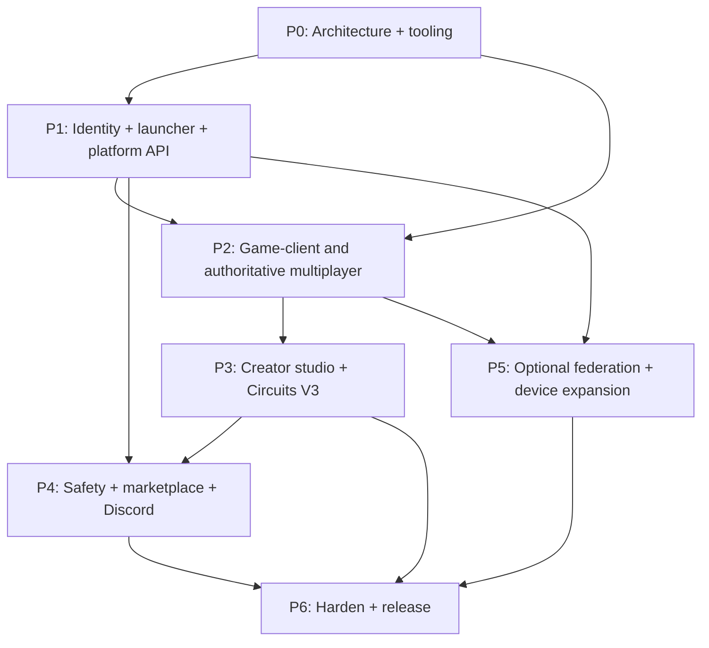

# Metallic Studios — Executable Engineering Roadmap

**Baseline date:** 2026-10-15 · **Revision:** v0.1 · **Status:** bootstrap planning  
**Canonical source of task state:** GitHub Issues in this repository. **Live counts:** [PROGRESS.md](PROGRESS.md).

> Important: Every feature below is a *proposed target*, not an implemented capability. The first implementation checkpoint is an independently hosted two-player room; later work is gated on a stable multiplayer core.

## Progress model — never confuse plans with shipped features

- Every deliverable has an issue titled `[P0]`, …, `[P6]`, a link to test evidence, an owner (when assigned), dependencies, and an acceptance checklist.
- **Backlog:** open issue without active label; **in progress:** open issue labeled `status:in-progress`; **blocked:** issue labeled `status:blocked`.
- **Task completed:** issue *closed after merging tested deliverables*. Milestone percent = closed scoped issues / all scoped issues (unweighted).
- **Release verified:** separate build artifact + test report + version + runnable deployment; issue completion by itself does not imply a shipped game.
- Changes to scope or closing/reopening issues automatically regenerate [PROGRESS.md](PROGRESS.md) and [progress.json](progress.json).
- A newly added issue can decrease percentage; this is correct because scope changed. Avoid 'fake' linear growth metrics.

## Dependency order

## Stage summary

| Stage | Goal | Example timeframe (small capable team, highly dependent on scope) | Exit proof |
| --- | --- | --- | --- |
| **P0** Foundation | Engine/network benchmark, ADRs, CI, local infra, prototype | Weeks 1–6 | Two local test clients boot; automated quality gates |
| **P1** Core platform | Identity, profiles, signed launcher, lobbies, deployments | Months 2–5 | Login -> launcher -> room discovery -> join with trace IDs |
| **P2** Playable slice | Realtime replication, avatars, VR controls, original social space | Months 4–9 | Two geographically distinct users in one tested server session |
| **P3** Creation | In-game pen, object sync, room publishing, CV3, asset catalogue | Months 7–15 | Creators build, test, save, publish and recover revisions |
| **P4** Community + economy | User safety, moderation, Discord, payments/ledger | Months 10–19 | Moderation/economy penetration and reconciliation tests |
| **P5** Interoperability + devices | Opt-in federation, multi-project launcher, supported import, Linux/mobile | Months 12–24+ | Participating project integration contract; verified device runs |
| **P6** Launch engineering | DDoS resilience, load tests, recovery, installers, website | Iterative; major gate months 16–30+ | Reproducible signed release, incident simulation, beta acceptance |

**These are aspirational ranges, not delivery promises.** One person building every requested capability could take multiple years. Multiple stages can overlap only once interfaces are stable.

## Focus areas added in October 2026

This roadmap now has **specialist implementation and quality specifications**. These documents define acceptance tests and tool choices, not released game capabilities:

| Workstream | Technical guide | Related issues |
| --- | --- | --- |
| Original product UI, launcher design and high-quality animation | [Visual design and VFX system](DESIGN_SYSTEM.md) | [#35](https://github.com/oncoursemail/Metallic/issues/35) / [#40](https://github.com/oncoursemail/Metallic/issues/40) / [#49](https://github.com/oncoursemail/Metallic/issues/49) |
| Synthetic players, game AI, soak/load, network failure & fleet performance | [Quality and stress lab](QUALITY_AND_STRESS_TESTING.md) | [#36](https://github.com/oncoursemail/Metallic/issues/36) / [#39](https://github.com/oncoursemail/Metallic/issues/39) / [#50](https://github.com/oncoursemail/Metallic/issues/50) |
| In-game/web/Discord administration, staff titles and permissions | [Moderation, Discord and staff system](MODERATION_DISCORD_STAFF.md) | [#43](https://github.com/oncoursemail/Metallic/issues/43)–[#47](https://github.com/oncoursemail/Metallic/issues/47) |
| Meta Quest launch, signing and device certification | [Meta Quest release checklist](META_QUEST_RELEASE.md) | [#48](https://github.com/oncoursemail/Metallic/issues/48) |
| Original development-status website (implemented preview) | [Website prototype](site/README.md) | [#35](https://github.com/oncoursemail/Metallic/issues/35) / [#51](https://github.com/oncoursemail/Metallic/issues/51) |
| Working Discord bot foundation (local code only) | [Discord implementation README](../services/discord-bot/README.md) | [#38](https://github.com/oncoursemail/Metallic/issues/38) / [#53](https://github.com/oncoursemail/Metallic/issues/53) |

**Current release truth:** the SVG progress tracker, static development website prototype, localhost synthetic room simulator and Discord bot skeleton have code/test evidence. The underlying multiplayer game client, account server, real game stress test, active moderation service and signed Quest binary do not yet exist. Review [PROGRESS.md](PROGRESS.md) for the machine-updated issue count (which may change as scope evolves), and see [FEATURE_CATALOG.md](FEATURE_CATALOG.md) for the 240 long-term feature proposals.

**Top actual feature dependency:** [#1 engine benchmark](https://github.com/oncoursemail/Metallic/issues/1) → [#4 original avatar/client](https://github.com/oncoursemail/Metallic/issues/4) + [#10 authoritative server](https://github.com/oncoursemail/Metallic/issues/10) → [#13 two-player room/quest](https://github.com/oncoursemail/Metallic/issues/13) → [#39 real protocol bots](https://github.com/oncoursemail/Metallic/issues/39) → [#50 fleet stress and reliability](https://github.com/oncoursemail/Metallic/issues/50). Simulated room-fixture tests alone cannot bypass this dependency.

## P0 — Architecture & developer platform

**Deliverables**
1. Compare Unity/OpenXR versus Godot/OpenXR on actual PCVR, Quest/mobile GPU, networking, export/build tooling, maintainer capacity, and custom-authoritative-server fit. Record ADR-0001 with a decision and benchmark evidence.
2. Define shared API contracts, repository structure, CI lint/build/test/security gates, dependency lockfiles, and signed artifacts.
3. Build an entirely local/staging dev environment: PostgreSQL, Valkey, telemetry pipeline, secrets isolation, reproducible migrations, and one-command bring-up.
4. Prototype client input, one avatar, head/hands tracking, and two simultaneous sessions in controlled testing; instrument frame time, allocations, and packet sizes.

**Exit gate:** A new contributor can check out the code, run unit tests, provision dev services, connect two clients, inspect logs and produce a versioned artifact.

## P1 — Foundation services & launcher

**Workstreams**
- Identity: verified email, passkeys or MFA, rate-limited session issuance, user settings, recovery, basic account export and delete.
- Profiles: inventory/event schema, avatar presets, friends/parties, privacy modes, moderation-safe aliases.
- Launcher: signed application manifest, verified download hashes, rollback protection, staged updates, channel selection, repair mode, crash reporting opt-in.
- Multiplayer directory: presence API, lobbies, reservations, room join tickets, region selection, heartbeat and room lifecycle.
- Reliability: database migrations, event outbox, audit logs, backups, restore drills, dashboards, infrastructure runbooks.

**Exit gate:** Test account signs in independently of Steam, installs signed dev launcher, selects a room, receives a short-lived join ticket, and reconnects safely.

## P2 — Realtime core + VR vertical slice

**Workstreams**
- Dedicated authoritative sessions, fixed-step simulation and per-room capacity; client prediction/reconciliation where appropriate.
- Interest management, quantized transforms, state deltas, bandwidth ceilings, jitter buffering, interpolation, reconnect and lag simulation.
- Avatar pipeline: original assets, head/hands IK, body and costume rig, tracked VR controllers; keyboard/mouse parity.
- Spatial voice with explicit opt-in, mute, block, reporting entrypoints, and measurable quality under loss.
- Original social lobby and a small 2–4-player cooperative challenge with checkpoints, interaction objects, scoring, and save/load.
- Load-testing agents (non-production), deterministic network-replay recordings, hardware compatibility, accessibility and VR comfort checks.

**Initial performance budgets to validate, not promises:**
- Target 72/90 FPS on selected VR headsets, with performance profiles and comfort settings.
- Server simulation target 20–30 Hz initially; measure before revising for fast-paced mini-games.
- p95 room join time under 5 s on tested regions, not including first install/download.
- p95 round-trip input-to-replication under a measured target based on distance (separately report RTT and processing latency).
- 0 server panics/crashes in a 1-hour two-player soak; expand to 24h/48h before beta.

**Exit gate:** End-to-end two-player multiplayer build with reproducible test results and no required official Rec Room or Steam backend.

## P3 — Creator system + CV3

**Maker Pen V1:** place/rotate/scale, snapping, align/distribute, gizmos, multi-select, object ownership, undo/redo, prefabs, save and collaborative edit sessions.

**Asset and publishing pipeline:** original upload manifests, texture/material budgets, mesh checks, asset scanning, creator attribution, revision history, moderation states, searchable approved catalogue, server-side room snapshots.

**Circuits V3 design:** stable graph IR with typed pins, events, pure/stateful nodes, execution quotas, memory/time budgets, deterministic server-relevant instructions, profiler/debugger, version upgrades, editable node documentation, multiplayer permissions, serialization and migration tests.

**CV3 implementation ladder:** events + booleans -> variables / math -> events across objects -> timers / physics bridges -> networked state -> persistent data -> debug/replay -> higher-level scripting, subject to sandboxing.

**Exit gate:** Two players edit/build a scene, save it, publish a revision, load it on another device, and interact with a small CV3 graph across an authoritative server.

## P4 — Trust, community, creator economy

- In-product reporting and appeals; staff roles with least privilege; tamper-evident audit trail and user privacy settings.
- Safe room discovery, age-appropriate controls, text/voice interaction defaults, human review queue, content labeling, block/mute, abuse rate limits.
- Transaction ledger with atomic transfers, idempotent settlement, reconciliation, refund/dispute paths; marketplace only after security review.
- Discord OAuth account link, opt-in Rich Presence; presence must not reveal private room IDs, sensitive room names, or hidden player location.
- Admin/creator website: session health, active rooms, uptime, moderation, marketplace insights, asset listings and incident dashboards.

**Exit gate:** End-to-end report escalation, moderation audit review, safe purchase sandbox, and user privacy test suite.

## P5 — Federation + platform breadth

- Agree on permissioned project registry and signed manifest format (versions, platforms, installer URLs, checksums, signatures, stable IDs, presence endpoint and privacy policy).
- External player counts only via opt-in cooperation, polling limits, freshness timestamps, clear provenance and aggregated numbers.
- Profile/data import only for verified user-supplied exports or supported proof of ownership; never request passwords or tokens from other services.
- Linux native support decision after launcher/renderer QA; Android and iOS profiling, touch controls, device thermal budgets and signed distribution; further VR headset ports on measured demand.

**Exit gate:** Two participating projects exchange signed manifest + aggregate health/status in integration tests; device matrix passes for every platform advertised as supported.

## P6 — Performance, protective infrastructure and release

- Segment control-plane HTTP from real-time game traffic and voice/media plane; protect each with appropriate mitigation, failover, and operational ownership.
- Benchmark 100/1,000/10,000 concurrency models with measured egress, CPU, memory, region latency, object storage, and database rate; do not confuse modeled targets with demonstrated capacity.
- Automated recovery, backups (3-2-1), restore exercise, image/container signing, SBOM, reproducible release pipeline, rollbacks and monitoring alerts.
- Closed alpha -> open beta -> staged release only after sign-off. Website downloads, releases, privacy controls, support escalation and status dashboard.

**Exit gate:** Signed installer and verified game session, measured load, restoration evidence, safety review and incident response drills.

## Quality gates for each issue/PR

1. Issue documents purpose, prerequisites, intended users, functional acceptance, performance/error budgets and testing method.
2. PR links issue with before/after proof (logs, screenshots, device video or build artifact as appropriate), plus unit/integration test commands.
3. Lint, types, unit tests, security/dependency review, platform-specific build pipeline (if relevant) pass.
4. For networking/database changes: simulated packet loss, replay/migration/failure tests, backward compatibility and no secret disclosure.
5. For UI/content: VR/desktop/mobile accessibility review, professional design review, alignment/layout, contrast, localization, frame pacing.
6. For production: observable SLOs, rollback path, runbook; close issue only when **acceptance criteria are met**.

## Feature register (post-vertical-slice backlog)

These do **not** count toward phase progress until converted into concrete issues with acceptance tests:

| Area | Expansion candidates |
| --- | --- |
| VR & social | Full-body IK, seated/standing calibration, hand tracking, adaptive locomotion, avatar facial performance, clubs, calendars, group parties, proximity interactions, spectator and replay mode |
| Creation | CV3 debugger, profiler and test runner; templates; custom materials, animation state machines, modular kits, audio sequencer, dynamic events, prefab marketplace, editor co-authoring, offline maker mode |
| Games | Original co-op quests, seasonal RRO-like experiences, racing, quests with leaderboards, PvE encounters, capture-the-flag, room tournaments, community-hosted events |
| Economy | Player stores, creator revenue analytics, bundles, subscriptions with fair utility, gifting, fraud-resistant reputation and dispute tools |
| Moderation | Room-specific staff tools, cross-server alerts, appeal dashboard, user-controlled audio/privacy, contextual text filtering, safe discovery, report evidence receipts |
| Infrastructure | Regional sessions, live capacity autoscaling, synthetic playtests, canary deploys, server fleet control panel, rollback and deep observability |
| Federation | Signed third-party manifests, interoperability capability matrix, separate account namespaces, opt-in deep linking and trustworthy opt-in player counts |
| Quality | Accessibility presets, controller remapping, subtitles, localization, motion comfort QA, graphics tiers, diagnostic export, creator performance advisor |

## Review cadence

- **Daily:** issues and tests; issue state drives automatic dashboard.
- **Weekly:** verify blocked items, scope creep, risk and benchmark results.
- **At every milestone:** require a runnable vertical slice, regression suite, and recorded evidence, not just issue closure.
- **At every release:** signed build and migration/recovery notes; announce only supported devices and verified features.

[View all current issue tasks](https://github.com/oncoursemail/Metallic/issues) · [Live completion dashboard](PROGRESS.md) · [Architecture](ARCHITECTURE.md)
