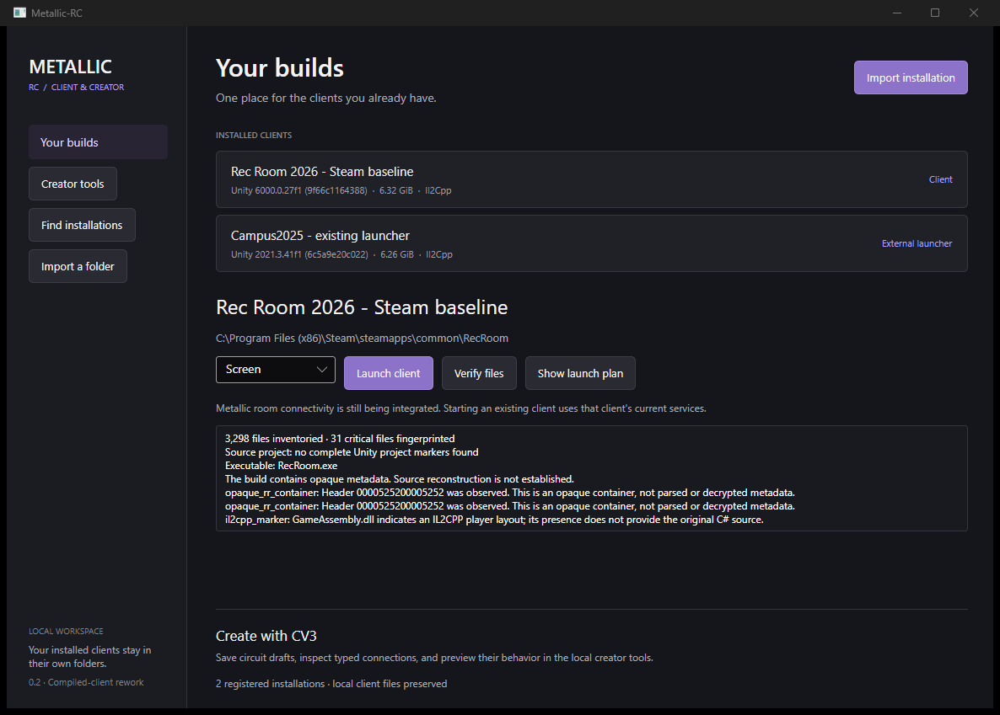

# Metallic-RC desktop handoff — 20 October 2026

The corrected C# launcher and local creator tools are built, installed on Main and retained as reviewable development packages. This checkpoint does not declare a rebuilt Rec Room executable or a completed compatible game server.

## Open the installed build

Use **Metallic-RC Launcher** on the Windows desktop. Its verified shortcut is:

`C:\Users\alexi\OneDrive\Desktop\Metallic-RC Launcher.lnk`

It opens:

`C:\Users\alexi\AppData\Local\Metallic-RC\rework-20261020\desktop-win-x64\Metallic.RC.Launcher.exe`

Both actual installations are registered: **Rec Room 2026 - Steam baseline** and **Campus2025 - existing launcher**. The former contains 3,298 inventoried files and 31 protected launch-file hashes; the latter contains 3,272 files and 40 hashes, with the existing Campus.exe explicitly registered. Both pass verification. These hashes establish the observed local baseline, not publisher authentication.

The source checkout is `C:\Users\alexi\AppData\Local\Metallic-RC\rework-20261020\source`. Both archives and SHA256SUMS.txt are in the sibling `packages` directory. The [installation receipt](desktop-installation-2026-10-20.json) records the saved shortcut target.

## Exact source and package provenance

Both delivered packages were built from clean commit **`70c32244d17bdaef815749b5582306955f2187cb`**. Later evidence-only commits do not change the 47 desktop build inputs or claim to have produced these earlier packages. Their input fingerprint remains `7d652604d8488e8740891dced3fd0787cc4ef5917e221772ba3353c0b8407608`.

| Archive | Bytes | SHA256 |
| --- | ---: | --- |
| `Metallic-RC-0.2-tools-win-x64.zip` | 98,158,674 | `497c15815e14b0f96829e9ec55c982262f000c5df12644b961e02ccd99024c82` |
| `Metallic-RC-0.2-tools-linux-x64.tar.gz` | 95,195,100 | `e2214709c82fb267fa5fd947efcc1723b2836c550531b5583a6ec721bf12d8f4` |

The [private draft release](https://github.com/oncoursemail/Metallic-RC/releases/tag/untagged-db7941be28d0d323b4b0) retains both archives and SHA256SUMS.txt. It remains **draft and prerelease**. The archives contain the .NET runtimes and Metallic tools; no Rec Room game binaries or user authentication files are redistributed. [Package records](desktop-packages-2026-10-20.json) and [release receipt](draft-release-2026-10-20.json).

## Native Windows acceptance

The final build on Main passed **18/18 Core checks and 101 Platform/Creator assertions**, and all **575 payload files** matched the package manifest's sizes and SHA256 values. The two additional Linux assertions test Unix file permissions. [Native build log](windows-final-build-2026-10-20.txt).

The launcher apphost uses PE subsystem **2 (Windows GUI)**. Successful CLI commands returned captured stdout with empty stderr; an invalid command returned JSON on stderr and exit 1. Both real-client verifications passed. The Steam screen plan points to its actual RecRoom.exe with `+forcemode:screen`. The Campus external plan points to the existing Campus.exe with no extra arguments. These were reviewed plans; the original game and third-party launchers were not run during acceptance. [CLI and package receipt](windows-final-cli-and-package-2026-10-20.json).

The application actually rendered on Main with both profiles and a correct count of two. Its captured outer window was **1186 × 849 pixels**. The following fresh screenshot contains only the application's window and was visually inspected:

Through Windows UI Automation, the actual **Creator tools** button started the bundled platform process. `/healthz`, `/api/v1/capabilities`, `/` and `/app.js` responded successfully. Closing the launcher stopped its owned child and released the port. A normal window close was observed; the GUI process's exit code was not captured. The [handoff receipt](windows-creator-handoff-2026-10-20.json) preserves that distinction.

The first test-harness request used the wrong unversioned capabilities URL and received 404. Correcting the probe to the implemented `/api/v1/capabilities` route required no product change.

## Exact uploaded Linux archive acceptance

The **exact uploaded tar.gz**, rather than only its source or a separate compilation, was downloaded from the private draft release and verified against its published archive hash. On Linux x86_64 with glibc 2.39 it passed all **571 payload hashes** and retained executable permissions. Its packaged launcher returned an empty isolated catalog, exit 0 and empty stderr.

The bundled service served the real health, workspace/capabilities, editor HTML and JavaScript endpoints. Pending game/voice/multiplayer flags remained false, and a missing API route correctly returned 404. The owned service exited 0 and stopped. [Exact-archive receipt](linux-uploaded-archive-2026-10-20.json).

The same 47 source inputs had separately passed native Linux **18 Core checks and 103 Platform/Creator assertions**. See the [broader validation record](COMPILED_CLIENT_VALIDATION_2026-10-20.md) for that build, the restored **40 Python / 62 Node** baseline tests, and the accurately scoped historical **10/10 real-browser** run. Historical screenshots were pruned and are not presented as surviving files. This new Linux archive smoke does not add a fresh Linux GUI, Wayland, physical headset or GPU performance result.

## Cleanup and hosted checks

The [final cleanup receipt](cleanup-final-2026-10-20.json) confirms that the old Meadow playtest directory, old shortcut and task-owned Godot data are absent. The active world, hub, Godot build/test workflow and session supervisor were removed from the replacement tree. Temporary recovery ZIP/base64 files containing rejected source were deleted after source publication. Original installed client files and other Metallic projects remain intact. Historical Git objects and the closed PR remain audit records.

[Draft PR #73](https://github.com/oncoursemail/Metallic-RC/pull/73) contains the corrected source and evidence. Its implementation commit is mergeable, but the PR remains draft and unmerged. The [compiled-client workflow run](https://github.com/oncoursemail/Metallic-RC/actions/runs/39415744512) failed before either native job ran steps. GitHub's actual annotation reports failed account payments or a spending-limit issue; the [Windows](github-windows-annotations-2026-10-20.json) and [Linux](github-linux-annotations-2026-10-20.json) annotations are retained.

`docs/DEVELOPMENT.md` requires passing CI before merge. Local acceptance does not override that rule. Resolving the account-level Actions blocker and rerunning the required checks is the merge gate; no billing settings were changed.

## Remaining game work

The recovered REA report, current installed-file inventory and compiled tools establish a concrete starting point. They do not establish a complete Unity source project, a rebuilt Rec Room executable, a compatible modern-client bootstrap, two-player room simulation, voice/reconnect, in-game CV3, native Android/Quest game, native Linux game or measured performance superiority.

The next playable gate is the actual modern client connecting to owned services, followed by two actual clients sharing a room and state, then voice/reconnect and device-specific acceptance. The local creator has typed graph editing, persistent drafts, validation and preview; it is not yet connected to game execution or deployed at Metallic.club. See [architecture](../COMPILED_CLIENT_REWORK.md), [REA recovery](REA_HISTORY_RECOVERY_2026-10-20.md) and [revival research](../REVIVAL_RESEARCH_2026-10-20.md).
